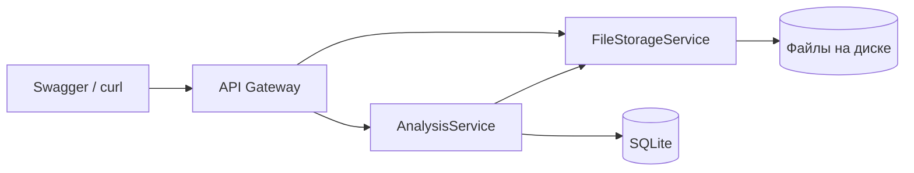

# AntiPlagiat

Учебная микросервисная система на **C# / .NET 8** для загрузки студенческих работ и поиска точных совпадений файлов по **SHA-256**.

Система сравнивает содержимое файлов в рамках одного задания и формирует отчёт. Она не определяет смысловое сходство, перефразирование или процент заимствования. Поле `isPlagiarism` обозначает обнаруженное точное совпадение с более ранней работой другого студента.

## Возможности

- Загрузка файла с идентификаторами студента и задания через API Gateway.
- Хранение файлов и скачивание по идентификатору.
- Сравнение SHA-256 с ранее загруженными работами по тому же заданию.
- Список сдач по заданию и подробный отчёт по сдаче.
- Swagger-интерфейсы трёх сервисов.

## Архитектура



| Компонент | Назначение |
|---|---|
| ApiGateway | Единая точка входа и вызовы внутренних API |
| FileStorageService | Запись и выдача файлов |
| AnalysisService | Сдачи, вычисление хэша и отчёты |
| Shared | Общие DTO |

Стек: ASP.NET Core Web API, Entity Framework Core, SQLite, HttpClient, SHA-256, Swagger/OpenAPI, Docker Compose.

## Запуск через Docker

Нужны Git и запущенный Docker Desktop. Порты 5036, 5037 и 5027 должны быть свободны.

```bash
git clone https://github.com/elinakocharyan777/anti-plagiat.git anti-plagiat
cd anti-plagiat
docker compose up -d --build
docker compose ps
```

Если папка уже скачана, начни с `docker compose up -d --build` внутри неё. Имя репозитория при публикации должно совпадать с адресом выше.

| Сервис | Swagger |
|---|---|
| Gateway | http://localhost:5036/swagger |
| File Storage | http://localhost:5037/swagger |
| Analysis | http://localhost:5027/swagger |

Логи: `docker compose logs --tail=100`. Остановка: `docker compose stop`.

В Compose предусмотрены тома для SQLite и файлов. При этом индекс метаданных файлов хранится только в памяти: после перезапуска FileStorageService ранее загруженные файлы могут стать недоступны через API, даже если их содержимое осталось на диске.

## Пример проверки

Из корня проекта в Terminal на macOS/Linux выполни:

```bash
# Первая работа
curl -X POST 'http://localhost:5036/api/Works' \
  -F 'studentId=s1' -F 'assignmentId=demo-1' \
  -F 'file=@examples/original.txt'

# Тот же файл от другого студента
curl -X POST 'http://localhost:5036/api/Works' \
  -F 'studentId=s2' -F 'assignmentId=demo-1' \
  -F 'file=@examples/original.txt'

# Другой файл
curl -X POST 'http://localhost:5036/api/Works' \
  -F 'studentId=s3' -F 'assignmentId=demo-1' \
  -F 'file=@examples/different.txt'

# Все отчёты по заданию
curl 'http://localhost:5036/api/Works/demo-1/reports'
```

Для нового задания ожидаются значения `isPlagiarism`: `false`, `true`, `false`. У второй сдачи `originalSubmissionId` указывает на первую. Для повторения сценария используй новый `assignmentId`.

Подробный отчёт: `GET /api/Works/submissions/{submissionId}/report`. Идентификатор возьми из ответа загрузки.

## Структура

```text
AntiPlagiat.sln
ApiGateway/
AnalysisService/
FileStorageService/
Shared/
examples/
docs/
docker-compose.yml
```

## Проверка и ограничения

Решение собрано в .NET SDK 8.0: 0 ошибок, 1 предупреждение. Основные API-сценарии проверены запуском собранных сервисов в изолированном Docker-окружении. Полная сборка образов штатными Dockerfile в рамках этой проверки не выполнялась.

Известные проблемы исходной версии:

- Ошибка скачивания файла скрывается: вместо SHA-256 используется FileId и создаётся отчёт со статусом `DONE`. Это нельзя считать успешной проверкой.
- Метаданные файлов хранятся в памяти и не восстанавливаются после перезапуска.
- Gateway превращает ответ 404 от AnalysisService в 503.
- Нет аутентификации и разграничения доступа; идентификатор студента передаёт клиент.
- Параллельная загрузка одинаковых работ требует отдельного тестирования; текущая проверка и сохранение не обеспечивают сериализацию таких запросов.

[Результаты проверки и приоритеты исправлений](docs/verification.md). Автоматизированных тестов и CI пока нет.

## Автор и происхождение

Элина Кочарян. Учебный проект по конструированию программного обеспечения.

[Исходный PR #4](https://github.com/elinakocharyan777/Dz-KPO/pull/4). История файлов выделена из подпапки `kpo-dz3/AntiPlagiat`; идентификаторы коммитов изменились. [Первоначальный учебный отчёт](docs/coursework-original.md) сохранён для контекста; актуальные ограничения описаны выше.
